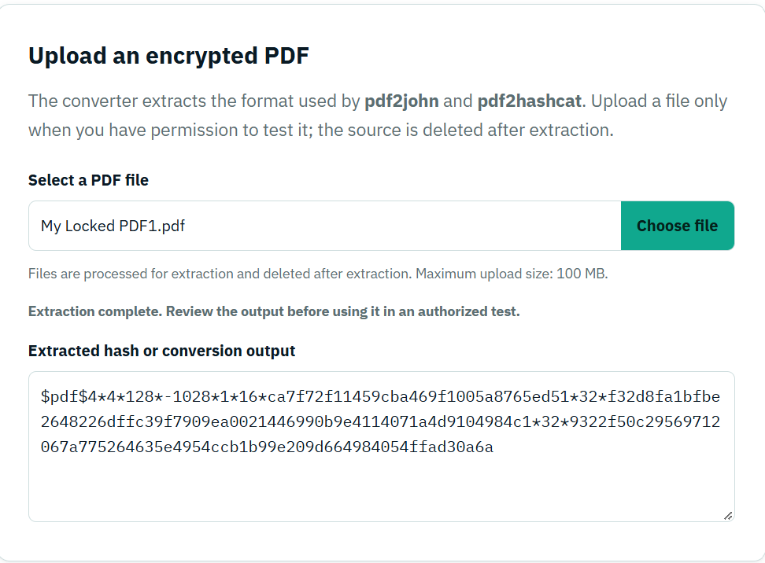
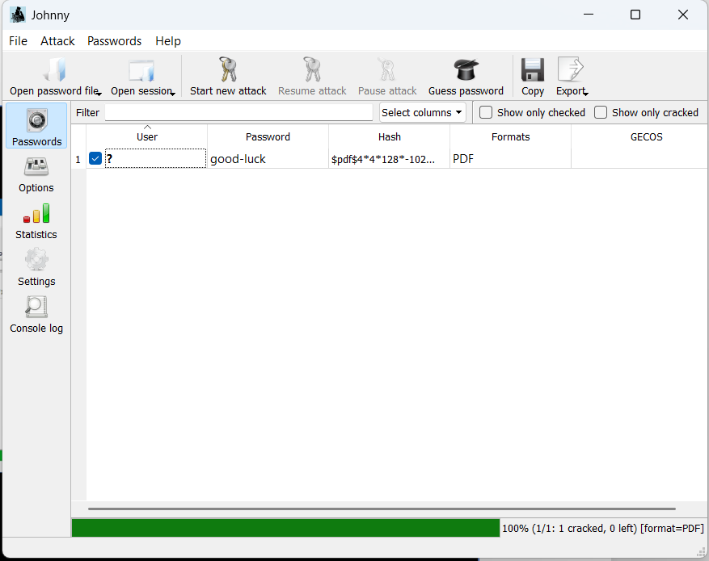
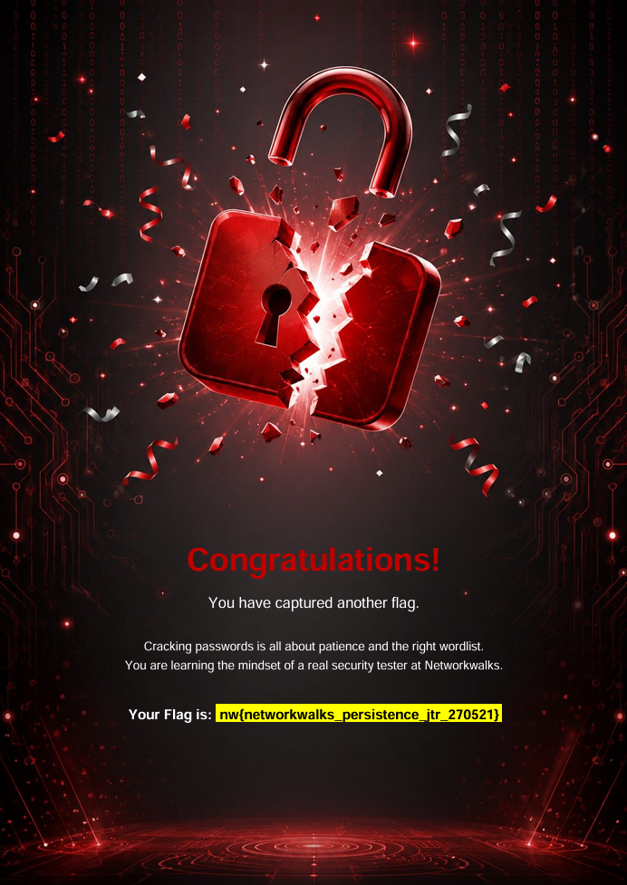
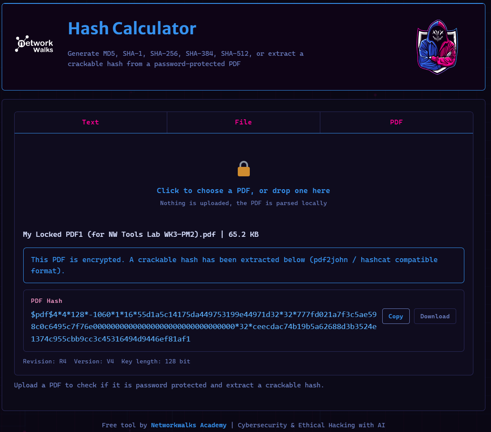
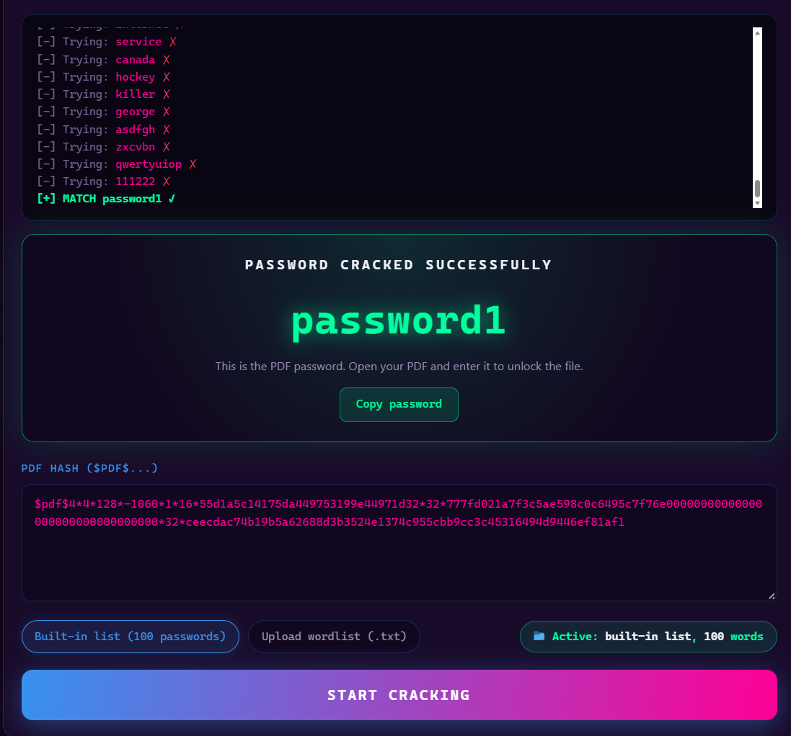

# Password Cracking Using JTR & NetworkWalks tools

**Author:** Sulafa Abdulrahman (Cybersecurity Intern)  
**Program/Batch:** Networkwalks-Cybersecurity Internship-B084

**Modules Completed:** 
* W3-PM1: Password Cracking with John the Ripper (JTR).
* W3-PM2: Password Cracking with Networkwalks Tools.
  

## ⚠️ 1. Educational & Liability Disclaimer
**Strictly for Educational Purposes.** The techniques demonstrated in this repository were performed in a controlled, authorized lab environment using intentionally vulnerable files provided by the instructor. The tools and methodologies used are documented solely for security research and education. I do not endorse or support any unauthorized access or malicious use of these tools. Always secure written permission before testing any system or file you do not explicitly own.

## 2. Introduction
During Week 3 of my cybersecurity internship, I explored password cracking techniques. The primary objective was to understand how attackers bypass file protections (like encrypted PDFs) by extracting their hashes and cracking them. 

To demonstrate proficiency across different methodologies, I completed two distinct projects:
1. **Command-Line / GUI Approach:** Cracking three separate protected PDF files using **John the Ripper (Johnny GUI)** to capture internal flags.
2. **Web-Based Attack:** Performing a targeted password cracking attack on a protected PDF using web tools (**Networkwalks Hash Calculator & Password Cracker**).

## 3. Tools Used
| Tool | Purpose |
| :--- | :--- |
| **John the Ripper (JTR) / Johnny GUI** | Advanced password cracking tool used to brute-force and match hashes. |
| **Online Hash Extractor (pdf2john)** | Extracted the crackable `$pdf$` hash from the locked PDF files. |
| **Networkwalks Hash Calculator** | Web-based tool to extract hashes from protected files. |
| **Networkwalks Password Cracker** | Web-based tool to match hashes against a wordlist for password recovery. |

## 4. Activities Performed

### 4.1 Phase 1: Password Cracking via John the Ripper (JTR)
To simulate an attacker gaining access to protected documents, I was tasked with unlocking three separate encrypted PDF files. To maintain a concise report, the methodology is outlined below without repeating the extraction steps for each file:

* **Step 1: Hash Extraction:** I utilized a hash extractor (powered by `pdf2john`) to extract the raw hash values (starting with `$pdf$`) from the encrypted PDF files.
* **Step 2: Password Cracking (Using Johnny GUI):** I saved the extracted hashes into text files and loaded them into **Johnny** (the GUI for John the Ripper). I initiated the attack, and the tool successfully matched the hashes to reveal the plaintext passwords.
* **Step 3: Capture the Flags (CTF) for the 3 Files:** Using the successfully recovered passwords, I unlocked all three PDF files and captured their respective internal flags.

### 4.2 Phase 2: Password Cracking via Networkwalks Tools
For the second phase, I utilized custom web-based tools to perform a targeted password cracking attack:
* **Hash Extraction:** I used the Networkwalks Hash Calculator to parse a locked PDF file and extract the hash.
* **Password Cracking:** I pasted the extracted hash into the Networkwalks Password Cracker. This tool matches the target hash against a wordlist.
* **Capture the Flag (CTF):** The tool rapidly matched the hash and successfully recovered the plaintext password (`password1`). Using this, I unlocked the file and captured the flag.

## 5. Lessons Learned & Security Recommendations

This practical exercise highlighted several critical security concepts:
* **The Absolute Necessity of Strong Passwords:** The labs proved that simple or common passwords (like `password1`) can be cracked in mere seconds. 
* **Vulnerability of File Protections:** Simply password-protecting a PDF or ZIP file is entirely ineffective if the password is weak. Attackers can extract the hash and crack it using powerful hardware without triggering account lockouts.
* **Hashing vs. Encryption:** I gained a practical understanding of the difference: Encryption is two-way (requires a key to decrypt), whereas hashing is a one-way mathematical function. Password crackers don't "decrypt" the hash; they rapidly hash millions of guessed words until they find a matching hash.
* **Remediation:** Organizations must enforce strict password complexity policies to mitigate the risk of password cracking.

## 6. Evidences Collected

### Phase 1: John the Ripper (JTR)
**1. Hash Extraction (pdf2john):**

**2. Password Cracked successfully using Johnny GUI:**

**3. Captured Flag (PDF File 1):**

**4. Captured Flag (PDF File 2):**

**5. Captured Flag (PDF File 3):**

---

### Phase 2: Networkwalks Tools 
**6. Hash Extraction via Hash Calculator:**

**7. Password Cracking Success via Password Cracker:**

**8. Captured Flag inside the unlocked PDF:**

